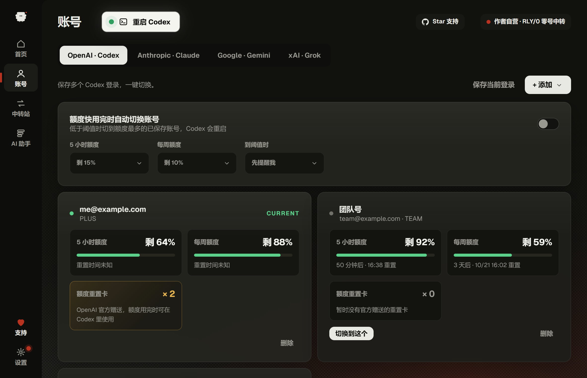
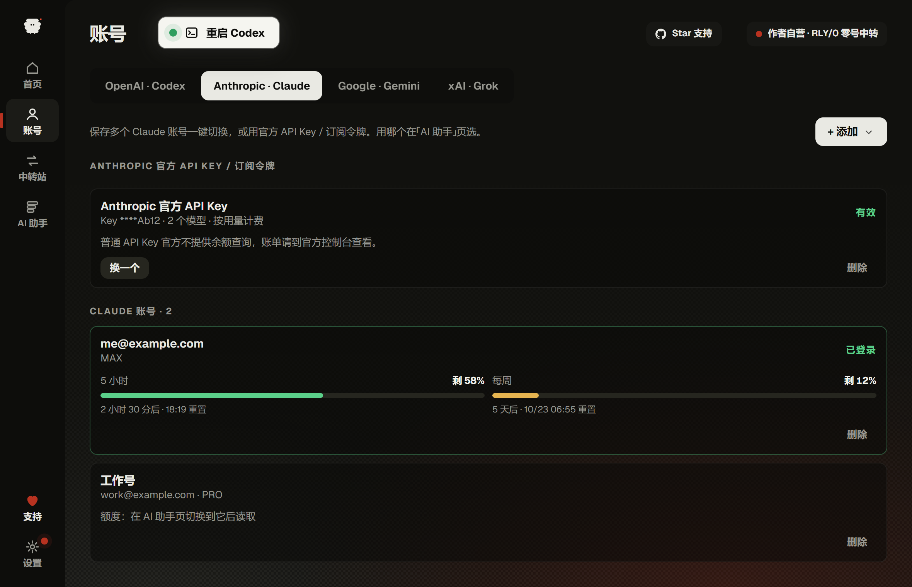
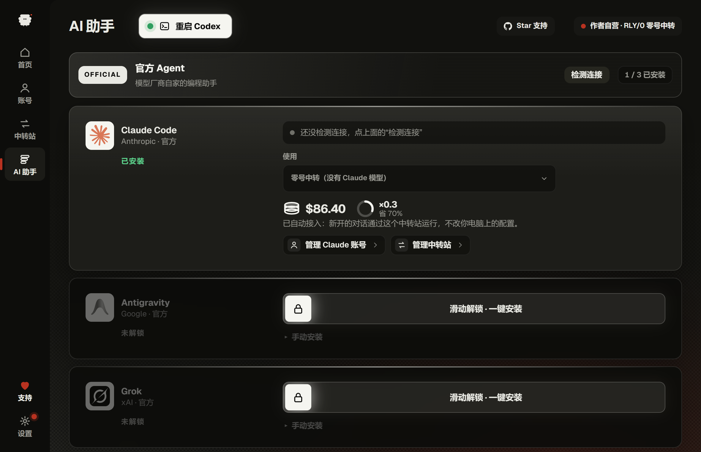
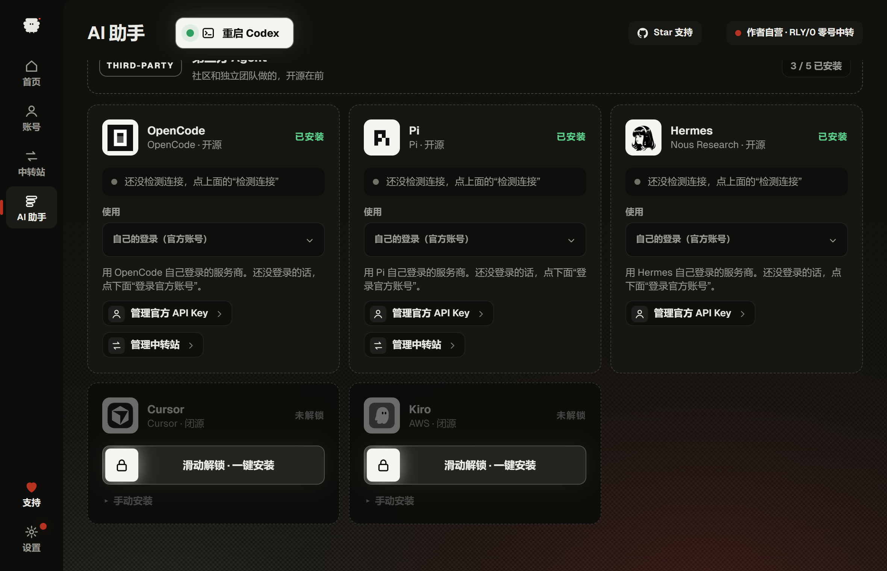
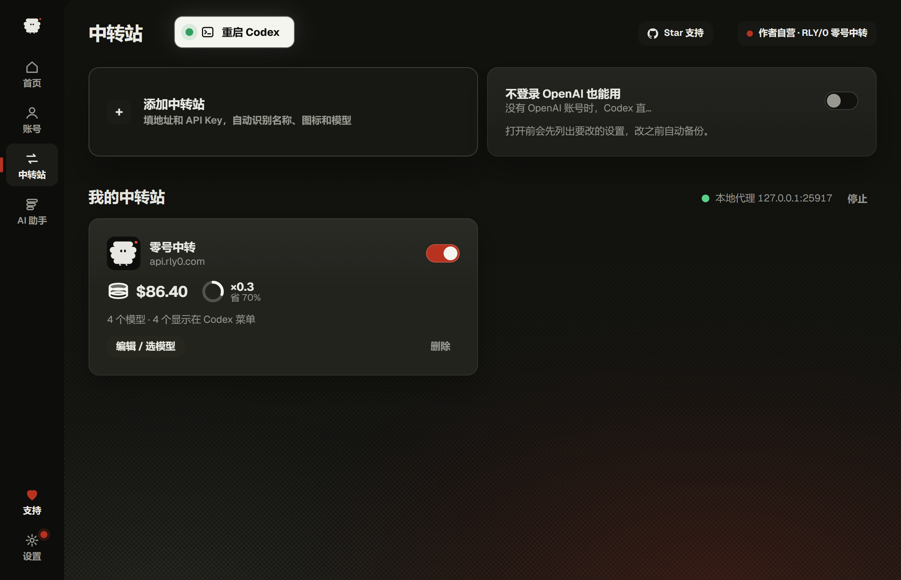
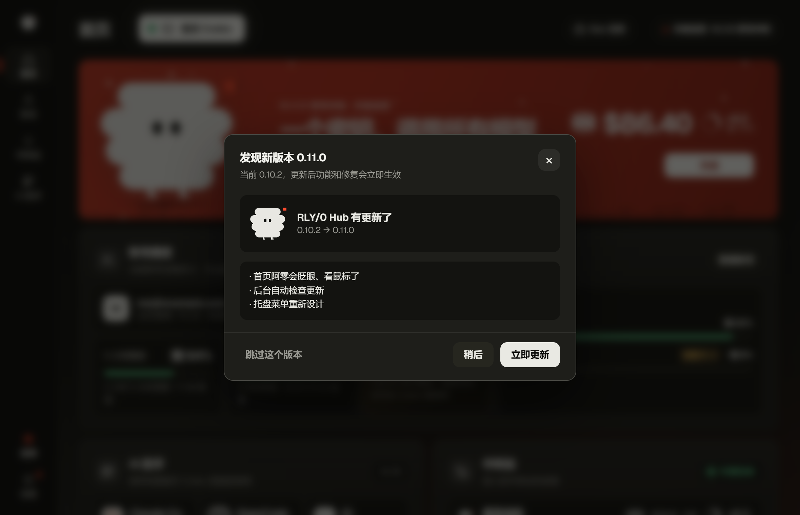

<div align="center">

# RLY/0 Hub

**One window for Codex and the other AI coding agents: multiple accounts, relays, and one-click Claude Code / Pi / Hermes / OpenCode**

[Download installer](https://github.com/a1039861261-stack/rly0-hub/releases/latest) · [中文](README.md)


</div>

## About

**RLY/0 Hub** is a derivative of [CodexHost](https://github.com/BytePioneer-AI/codex-host) v0.10.2, forked at that
version. CodexHost lets you run other Agent Harnesses (Pi, Claude Code, and more) natively inside **Codex Desktop**.
RLY/0 Hub adds a standalone management window (living in the tray) for multiple accounts, relays, and installing and
switching agents — switching an account or relay does not require restarting Codex.

RLY/0 Hub **does not bundle or redistribute Codex Desktop, Claude Code, or any other third-party harness**. You
install those yourself from their official sources (the Hub's one-click install only runs the official install
command after you confirm).

## Screenshots

<table>
  <tr>
    <td width="50%"></td>
    <td width="50%"></td>
  </tr>
  <tr>
    <td align="center"><b>Codex accounts</b>: 5-hour / weekly quota, reset credits, one-click switch</td>
    <td align="center"><b>Claude accounts</b>: subscription quota, official API key / subscription token</td>
  </tr>
  <tr>
    <td></td>
    <td></td>
  </tr>
  <tr>
    <td align="center"><b>Agents</b>: choose the account / key / relay each agent uses</td>
    <td align="center"><b>Third-party agents</b>: Pi, Hermes, OpenCode with one-click install</td>
  </tr>
  <tr>
    <td></td>
    <td></td>
  </tr>
  <tr>
    <td align="center"><b>Relays</b>: enter URL and key; name, logo and models are detected</td>
    <td align="center"><b>Auto update</b>: checked in the background, prompts when a new version is out</td>
  </tr>
</table>

> Accounts and balances in the screenshots are demo data. The UI is currently Chinese-only.

## Features

- **Home**: current account quota, official reset credits, installed agents and relay balance at a glance.
- **Accounts** (OpenAI · Codex / Anthropic · Claude / Google · Gemini / xAI · Grok tabs):
  - Each vendor can be added three ways: web login, importing a login file (including Sub2API exports), or an
    official API key.
  - Codex and Claude support multiple saved accounts with one-click switching and 5-hour / weekly quota with reset
    times; switching Codex accounts needs no restart.
  - Optional automatic switch to the account with the most quota when one runs low (ask first, or switch directly).
- **Relays**: adding a relay tests it, detects its name and logo, and lets you pick GPT models; the local proxy only
  listens on `127.0.0.1`, routes by model name, and the official config can be restored in one click. Includes a
  "use without an OpenAI login" mode.
- **Agents**: Claude Code, Antigravity, Grok, OpenCode, Pi, Hermes, Cursor, Kiro and more; one-click install (runs the
  official command in a visible terminal window), connection checks, and a per-agent choice of account / official
  key / relay that takes effect immediately.
- **Settings**: MCP servers, Skills, AGENTS.md instruction templates, thread management, maintenance (diagnostics,
  redacted log bundle, restart Codex), appearance and launch-at-login, updates.
- **Tray**: stays in the tray; the context menu switches accounts, opens Codex and toggles launch-at-login.
- **Auto update**: checks GitHub Releases in the background, shows a prompt and a red dot on "Settings" when an update
  is available.

## Open source and closed source

- The public repository as a whole is licensed under the **GNU Lesser General Public License v3.0 (LGPL-3.0)**,
  inherited from upstream CodexHost. The original CodexHost [`LICENSE`](./LICENSE) file and all copyright notices are
  kept unchanged (see [`NOTICE.md`](./NOTICE.md)).
- **Multi-account switching, quota reading, and relay routing / the local proxy** are implemented in a closed-source
  component, **RLY/0 Core (`rly0-core`)**. It runs as a **separate process** and communicates with this repository's
  code over **JSON-RPC on stdio**; it does not contain, link against, or embed any CodexHost code — the two are
  independent executables talking over an inter-process protocol.
- **This public repository builds and runs fine without RLY/0 Core installed**: the features above simply show
  "requires RLY/0 Core" in the UI, while everything else (dashboard, thread management, MCP/Skills management,
  maintenance tools, appearance, etc.) keeps working normally.
- See [`docs/CLOSED_SOURCE.md`](docs/CLOSED_SOURCE.md) for more on the LGPL compliance rationale.

## Privacy and security

- Account snapshots and relay API keys are encrypted with **Windows DPAPI** before being written to disk on the local
  machine.
- The local proxy used by relay injection **only listens on `127.0.0.1`**; it never opens a port to the network.
- RLY/0 Hub and its closed-source component **do not collect or upload any user data** to the author or any third
  party.
- The "Maintenance" page's diagnostic bundle is **saved locally only** and has sensitive fields redacted; there is no
  "send diagnostics to the author" feature.
- See [`docs/PRIVACY.md`](docs/PRIVACY.md) for details.

## Advertising disclosure

The relay-injection page includes a recommended entry for **RLY/0 · Zero Relay** (<https://rly0.com>), operated by the
author personally and always clearly labeled as such in the UI; clicking it only opens rly0.com. This entry:

- does not change how any request is routed;
- does not lock you into using that relay;
- does not collect any relay API key you add yourself.

## Sponsorship

RLY/0 Hub's in-app "About" page has a **voluntary** sponsorship entry point; using or ignoring it has no effect on any
feature. This README does not include a payment QR code — see the in-app "About" page for the actual entry point.

## Acknowledgements and disclaimers

- Thanks to the [CodexHost](https://github.com/BytePioneer-AI/codex-host) project and its author/contributors: RLY/0
  Hub is a derivative work based on CodexHost v0.10.2; the original copyright and license terms are kept in this
  repository's [`LICENSE`](./LICENSE) and [`NOTICE.md`](./NOTICE.md).
- Some UI/interaction ideas (e.g. account management, relay injection) were inspired by AiMaMi's interface design;
  no code from it is included.
- RLY/0 Hub is not affiliated with OpenAI or Anthropic. Codex, Claude, and similar names are trademarks of their
  respective owners, mentioned here only to describe compatibility.

## Build

Requirements: official Codex Desktop, Node.js 22.19+ or 24, and Rust.

```bash
git clone https://github.com/a1039861261-stack/rly0-hub
cd rly0-hub
npm ci
npm start
```

Full build (TypeScript + renderer extension + Rust components):

```bash
npm run build
```

Or step by step:

```bash
npm run build:typescript   # tsc -b + plugin bundling
npm run build:renderer     # build @codexhost/renderer-extension
npm run build:rust         # build launcher / platform / shim / updater Rust crates
```

Tests:

```bash
npm test                   # TypeScript + Rust tests
npm run typecheck
npm run lint
```

See [`CONTRIBUTING.md`](CONTRIBUTING.md) for the contribution workflow.

---

[简体中文 README](README.md)
