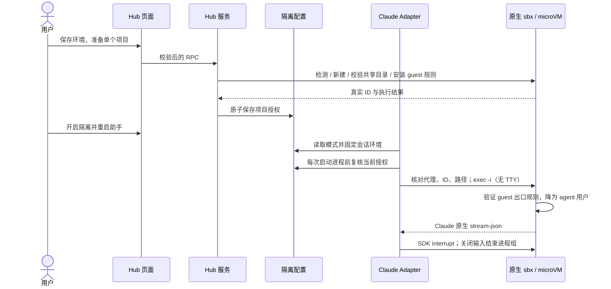

# Claude Code 隔离保护

Hub 的「AI 助手 → Claude Code → 隔离保护」支持 Windows 上的 Docker Sandboxes。本地 Claude 可以保留；没有本地 Claude 也可以使用沙箱模板内的 Claude。此功能保护运行环境和授权目录，不承诺避免账号封禁，也不隐藏服务端看到的账号或出口 IP。

## 使用和状态

1. 没有 Docker Sandboxes 时，从此入口安装官方 `Docker.sbx`；安装后重新发现可执行文件，不能仅凭安装器退出码判定成功。
2. 选择隔离数据目录和已有的本机 HTTP / SOCKS5h 代理，保存。代理不接收用户名、密码；数据目录通过 Docker 子进程的 `LOCALAPPDATA` 指定，不修改全局环境。已有隔离环境应填写原数据目录。
3. 完成 Docker 登录；填写单个项目的完整路径，新建沙箱或接管兼容沙箱。接管要求 agent 为 Claude、只有一个共享目录且路径完全匹配。记录 Docker 的实际 ID，重建同名沙箱后需要重新接管。
4. 在对应沙箱窗口中完成 Claude 登录。Windows 的凭据不会复制进去；Hub 分别显示本地安装、沙箱存在和沙箱登录，已停止的沙箱不会仅因打开页面而启动。
5. 开启隔离，并在保存现有任务后重启 Codex，让插件读取新模式。已有 SDK 进程保持其原环境；新进程在授权被撤销、代理配置变化或沙箱不匹配时拒绝启动，不退回本地 Claude。

准备和安装使用单任务状态；重复提交被拒绝。取消准备会使原任务失效，完成中的 Docker 镜像拉取可能仍继续，但结果不会自动写入授权。不会为取消操作删除沙箱或项目。移除项目只撤销新进程授权；现有会话需自行结束。恢复本地模式是明确操作，且需要重载助手。

## 所有权与边界

- `shared-contracts` 保存浏览器可用的参数和配置 schema。
- `sandbox-runtime` 提供 Docker 原生 CLI 的调用、严格配置读取、路径和实际共享目录复核。原生 `sbx` 管理 microVM；不另造宿主进程管理器或复制宿主凭据。
- Hub 服务拥有安装、环境设置、准备任务和授权写入。配置位于 Hub 数据目录的 `claude-isolation.json`，遵循 `CODEXHOST_DATA_DIR`。
- Claude Adapter 拥有 SDK spawn、流式事件、原生 Session ID、恢复和沙箱内的 transcript 读取。隔离模式忽略本地 Claude 可执行文件覆盖；每个新进程只允许已授权的确切项目工作目录。没有配置为本地模式；配置损坏或不可读则报错停止。
- SDK 输入关闭时 guest supervisor 结束该进程组；SDK interrupt 继续使用 Claude 自身协议。会话和子代理历史只从该项目对应沙箱读取，不扫描 Windows Claude 历史。
- 实时文件变更只将共享项目内的 guest 路径映射回 Windows，供 Codex 展示变更链接；项目以外的 guest 路径不转换成宿主文件。
- 第一版沙箱会话不提供分叉、回滚和 Windows 原生会话导入；能力声明和后端拒绝行为一致。普通本地模式保留原能力。

## 网络保护的实际范围

新建沙箱禁用共享 skills，并添加对宿主入口、私有和链路本地网段的拒绝项。每次 SDK 启动前验证 Docker 上游代理设置与选择一致，并检查本机代理端口可连接；然后在同一次 guest exec 中建立或严格核对自有 IPv4/IPv6 出口链，只放行 guest 本地回环、内部 DNS 和 Docker 代理端口。规则不完整会阻止 Claude 启动；多个会话不刷新已有规则。

这些规则会在 VM 重启后重新应用。此版本没有安装 Windows WFP 规则，没有改全局防火墙，没有为所有 Docker 环境设置全局允许列表，也不保证代理服务提供固定 IP。端口检测不是目标站出口检测；状态是检测时的快照。模板内具有 sudo 权限的 agent 可以改变 guest 规则，因此主要隔离边界仍是 Docker microVM 和外层策略。用户此前手动配置的宿主 WFP 防护属于独立配置，不视为其他用户默认已有的产品能力。

本地源码构建、浏览器 mock、隔离测试状态和正式安装互相独立。真实模型请求、跨重启恢复和订阅登录需要真实沙箱验收；不能用 mock 成功或 CLI 版本输出代替。
